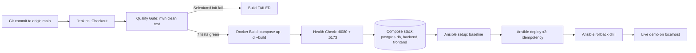

# REC Platform — End-to-End Architecture & Pipeline Guide

## 1. System overview

The Renewable Energy Certificate (REC) Platform is a full-stack, containerized
application with a CI-gated release pipeline and Ansible-managed provisioning:

- **Frontend:** React 18 + TypeScript + Vite, served by Nginx (`frontend/Dockerfile`, `frontend/nginx.conf`).
- **Backend:** Java 17, Spring Boot 3.3.4, Spring Security JWT, Spring Data JPA, Flyway (`backend/pom.xml`, `backend/Dockerfile`).
- **Database:** PostgreSQL 16 (`postgres:16-alpine`), Flyway schema v2, persistent `postgres_data` volume.
- **CI/CD:** Jenkins declarative pipeline (`Jenkinsfile`) on `http://localhost:8081`.
- **Config management:** Ansible playbooks in `ansible/` executed from ephemeral Ubuntu 22.04 containers on Docker Desktop.

## 2. Complete lifecycle (ASCII)

```text
  git commit/push (origin main)
        |
        v
  +------------------- Jenkins: rec-platform-pipeline -------------------+
  | 1. Checkout (git SCM, branch main)                                   |
  | 2. Quality Gate:  cd backend && mvn clean test                       |
  |      - WorkflowServiceTest (3 unit tests: state machines)            |
  |      - EndToEndTests (4 Selenium journeys, headless Chrome)          |
  |      - Surefire XML -> junit publisher; failures FAIL the build      |
  |      - Failure screenshots -> backend/target/screenshots/            |
  | 3. Docker Build & Verification: docker compose up -d --build         |
  |      -> rec-backend:v1.0.0, rec-frontend:v1.0.0                       |
  | 4. Health Check: /api/auth/roles (8080) + / (5173) must return 200   |
  +----------------------------------------------------------------------+
        |
        v
  Docker Compose deployment (docker-compose.yml)
   postgres-db (5433:5432, healthy) -> backend (8080:8080) -> frontend (5173:80)
        |
        v
  Ansible provisioning (ephemeral ubuntu:22.04 + /var/run/docker.sock)
   rec-platform-setup.yml  -> host baseline (recadmin, /opt/rec-platform, UFW)
   rec-platform-deploy.yml -> provision + deploy + health (run twice: changed=0)
   rec-platform-rollback.yml -> stop/start recovery + post-recovery checks
```

## 3. Complete lifecycle (Mermaid)



## 4. Component interaction map

```text
Browser / Selenium (headless Chrome)
   |  http://localhost:5173  (Vite dev) or Nginx :80 in container
   v
+-----------------+     /api/* proxied by nginx.conf     +------------------+
| React frontend  |  ----------------------------------> | Spring Boot API  |
| :5173 (host)    |      JWT Bearer in Authorization      | :8080 (host)      |
+-----------------+                                       +--------+---------+
                                                                   | JDBC
                                                                   v
                                                          +------------------+
                                                          | PostgreSQL 16    |
                                                          | host :5433       |
                                                          | container :5432  |
                                                          | volume:          |
                                                          | postgres_data    |
                                                          +------------------+
```

Key contracts:

| Caller | Target | Purpose |
|---|---|---|
| Frontend Axios | `GET /api/v1/auth/roles` | Public health probe + role list (`["ADMIN","GENERATOR","BUYER"]`) |
| Frontend Axios | `/api/v1/auth/login`, `/register`, `/me` | JWT auth |
| Frontend Axios | `/api/v1/assets`, `/generation-logs`, `/recs`, `/dashboard/summary` | Domain APIs |
| Selenium | `http://localhost:5173` (+ proxied `/api/*`) | 4 E2E journeys |
| Jenkins health stage | `:8080/api/auth/roles`, `:5173/` | Release gate |
| Ansible deploy/rollback | `host.docker.internal:8080/:5173/:5433` | In-container health checks |

## 5. Repository map

```text
rec-platform/
  backend/            Spring Boot app + Dockerfile + Selenium suite
    src/main/java/com/platform/recs/   controllers/services/security/...
    src/test/.../WorkflowServiceTest.java + e2e/EndToEndTests.java
  frontend/           React/Vite app + Dockerfile + nginx.conf
  ansible/            ansible.cfg, inventory/hosts.ini,
                      rec-platform-setup.yml, rec-platform-deploy.yml,
                      rec-platform-rollback.yml
  scripts/            run-phase9-validation.ps1, run-ansible-setup.ps1,
                      deploy-docker.ps1, docker-rollback.ps1, ...
  docs/               architecture-and-pipeline.md (this file),
                      troubleshooting-guide.md, limitations-and-future-scope.md,
                      viva-defense-guide.md, phase9-reliability-validation.md,
                      phase9/ (raw PLAY RECAP + health logs), ...
  Jenkinsfile         4-stage declarative pipeline (no tools{} block)
  docker-compose.yml  postgres-db -> backend -> frontend
```
